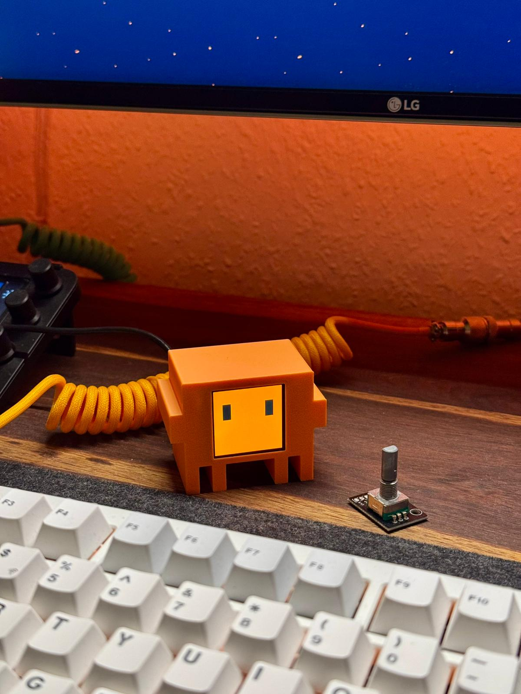
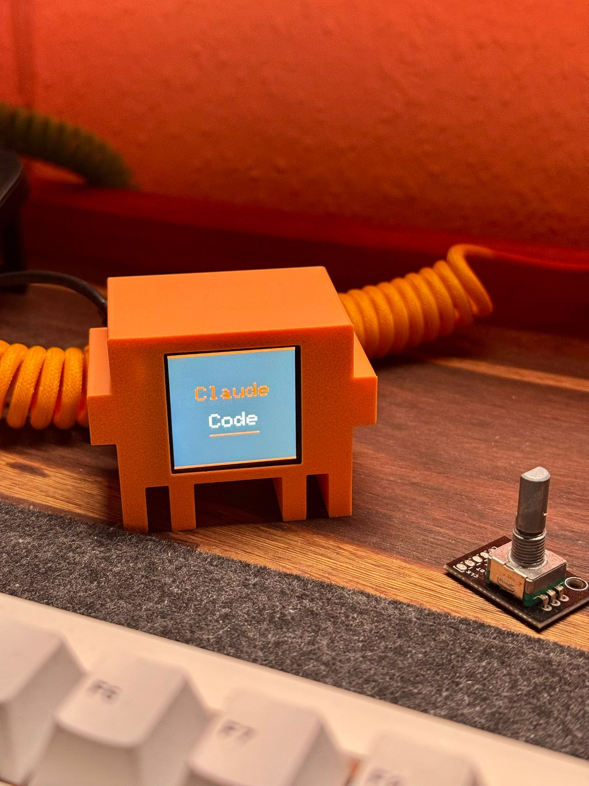
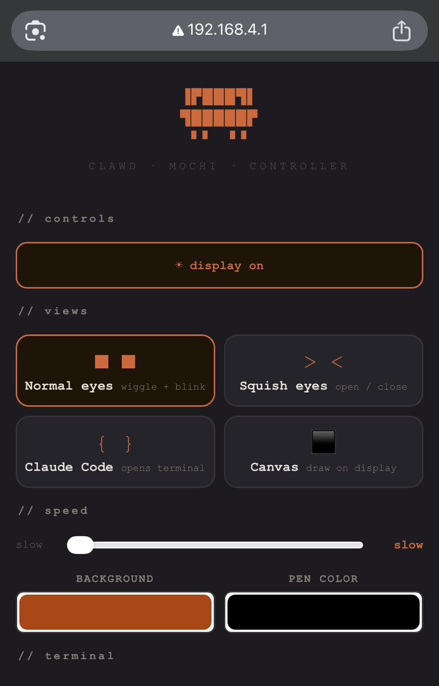
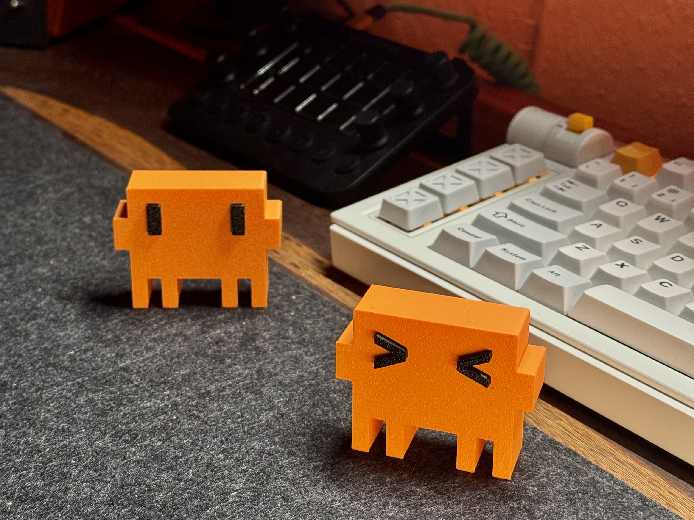

<!-- LOGO -->
<p align="center">
  
</p>

# Clawd Mochi 🦀🤖

A physical desk companion inspired by **Clawd** — the pixel-crab mascot of Claude Code by Anthropic. An ESP32-C3 drives a 1.54" color TFT display and hosts a mobile web controller — no app, no internet, no cloud required.

**Cost: ~$6–8 · Build time: ~1 hour · Skill level: Beginner**

Support the project on Instagram: [](https://instagram.com/clawd.mochi)

📦 3D printable case on MakerWorld: [https://makerworld.com/en/models/2559505-clawd-mochi-physical-claude-code-mascot#profileId-2820000](https://makerworld.com/en/models/2559505-clawd-mochi-physical-claude-code-mascot#profileId-2820000)

---

> ⚠️ This is an independent fan project. It is not affiliated with, sponsored by, or endorsed by Anthropic. "Claude" and "Clawd" are trademarks of Anthropic.

---

<p align="center">
  
  &nbsp;
  
</p>

## What it does

Clawd Mochi sits on your desk and shows animated expressions on a small color display. You control it from any phone or browser by connecting to its built-in WiFi hotspot. No app, no internet, no cloud required.

### 😊 13 Animated Expressions

| Expression | Description |
|-----------|-------------|
| **Normal** 👀 | Wiggle + blink animation |
| **Happy** 😊 | `> <` squint with open/close |
| **Angry** 😠 | Slanted brows, narrowed pupils + shake |
| **Heart** 💗 | Pulsing heart eyes |
| **Dizzy** 😵 | X eyes → spiral animation |
| **Sleepy** 😴 | Droopy half-closed slits |
| **Wow** 😲 | Wide eyes with small pupils |
| **Wink** 😉 | Alternating left/right wink |
| **Cry** 😢 | Pleading pupils + blue tear drops |
| **Star** ⭐ | Sparkle cross with flash effect |
| **Shy** 😊 | Sideways glance + pink blush |
| **Puppy** 🐶 | Big shiny pleading eyes |
| **Logo** ⭐ | Anthropic logo reveal animation |

### 🕐 Clock & Weather

- **Digital clock** — large time display with date, weather summary, and city name
- **Analog clock** — classic clock face with hour/minute/second hands, smooth sweep
- **Weather view** — temperature, humidity, wind speed, weather condition from Open-Meteo API
- **Auto time sync** — NTP time sync via home WiFi (optional STA mode)
- **Location** — manual lat/lon, city geocoding, or IP auto-detect

### ⏰ Alarms & Timer

- **Up to 8 alarms** — set hour/minute, enable/disable, configurable ring duration (5s–5min)
- **Countdown timer** — hours:minutes:seconds, progress bar, start/pause/reset
- **Buzzer support** — connect to GPIO 6 for alarm/timer sound

### 🎨 Other Features

- **Dance animation** — plays the classic b4.gif dance loop on screen
- **Auto-switch mode** — cycles through expressions or info views automatically
- **Terminal** — interactive terminal on the TFT, type from the web controller
- **Canvas** — draw on the display from your phone in real time, 240×240 resolution
- **Animation speed** — slow / normal / fast (3 levels)
- **Custom background color** — any hex color via web color picker
- **Backlight toggle** — turn display on/off remotely

### 🌐 WiFi Modes

- **AP mode** (default) — creates its own WiFi hotspot `ClaWD-Mochi`, connect directly
- **STA mode** (optional) — connects to your home WiFi for internet access (NTP + weather)
- **Dual mode** — AP always available, STA connects in background

---

## Parts list

| Part                | Spec                             | ~Price |
| ------------------- | -------------------------------- | ------ |
| ESP32-C3 Super Mini | microcontroller with WiFi        | ~$2.50 |
| ST7789 1.54" TFT    | 240×240 SPI color display        | ~$3.00 |
| 8 short wires       | 8–10 cm Dupont / jumper wires    | ~$0.50 |
| 2× M2×6mm screws    | to mount display bezel           | ~$0.10 |
| Double-sided tape   | to secure components inside case | ~$0.10 |
| USB-C cable         | for power                        | —      |
| 3D printed case     | PLA or PETG, ~30g                | ~$0.50 |

**Total: ~$7–8**

---

## Wiring

> ⚠️ Connect VCC to **3.3V only** — never 5V. Use GPIO 8 and 10 for SPI (hardware SPI, fast). Do not use GPIO 6/7 for SPI.

| Display pin | ESP32-C3 GPIO  | Wire color (suggested) |
| ----------- | -------------- | ---------------------- |
| VCC         | 3V3            | Red                    |
| GND         | GND            | Black                  |
| SDA         | GPIO 10 (MOSI) | Orange                 |
| SCL         | GPIO 8 (SCK)   | Green                  |
| RES         | GPIO 2         | Purple                 |
| DC          | GPIO 1         | Blue                   |
| CS          | GPIO 4         | White                  |
| BL          | GPIO 3         | Yellow                 |

---

## Software setup

### Step 1 — Install Arduino IDE

Download [Arduino IDE 2.x](https://www.arduino.cc/en/software) and install it.

### Step 2 — Add ESP32 board support

1. Open Arduino IDE → **File → Preferences**
2. In "Additional boards manager URLs" paste:
   ```
   https://raw.githubusercontent.com/espressif/arduino-esp32/gh-pages/package_esp32_index.json
   ```
3. Go to **Tools → Board → Boards Manager**, search `esp32`, install **"esp32 by Espressif Systems"**

### Step 3 — Install libraries

Go to **Tools → Library Manager** and install both:

- `Adafruit GFX Library`
- `Adafruit ST7735 and ST7789 Library`

### Step 4 — Configure board settings

Go to **Tools** and set:

| Setting         | Value                   |
| --------------- | ----------------------- |
| Board           | ESP32C3 Dev Module      |
| USB CDC On Boot | **Enabled** ← important |
| CPU Frequency   | 160 MHz                 |
| Upload Speed    | 921600                  |

### Step 5 — Upload the sketch

1. Clone or download this repo
2. Open `clawd_mochi/clawd_mochi.ino` in Arduino IDE
3. Connect the ESP32 via USB-C
4. Select the correct port under **Tools → Port**
5. Click **Upload** (→ arrow button)
6. Wait for "Hard resetting via RTS pin..." — this means success

---

## How to use it

### Connect and open the controller

1. Power the ESP32 via USB-C (any USB charger or power bank)
2. Wait ~3 seconds for the boot animation to finish
3. On your phone or computer, go to **WiFi settings**
4. Connect to the network: **`ClaWD-Mochi`** · password: **`clawd1234`**
5. Open a browser and go to **`http://192.168.4.1`**

You should see the web controller:



### Optional: Connect to home WiFi (for clock + weather)

To get automatic time sync and live weather, configure your home WiFi in `clawd_mochi.ino`:

```cpp
const char* STA_SSID = "YourWiFiName";    // your home WiFi
const char* STA_PASS = "YourPassword";    // your WiFi password
```

And set your location:

```cpp
#define MY_LAT          30.19     // your latitude
#define MY_LON          105.84    // your longitude
#define MY_CITY_NAME    "Chongqing"  // displayed on screen
#define MY_TZ_OFFSET    8         // UTC offset (China=8, Japan=9, UK=0, US/East=-5)
```

Leave `MY_LAT` at `0` to auto-detect location via IP geolocation, or set `MY_CITY` to a city name for geocoding.

### Controller features

**TFT Display section:**
| Button | What it does |
|--------|-------------|
| Clock | Switch to digital clock view with time, date, weather |
| Analog | Switch to analog clock face |
| Weather | Switch to full weather view (temp, humidity, wind) |
| Terminal | Open interactive terminal mode |
| Timer | Switch to countdown timer view |
| Dance | Play the b4.gif dance animation loop |

**Eyes section:**
| Control | What it does |
|---------|-------------|
| 13 expression tiles | Tap any tile to play its animation instantly |
| Background color | Color picker — changes background of all views |
| Speed buttons | Slow / Normal / Fast — controls animation playback speed |

**Auto Switch section:**
| Control | What it does |
|---------|-------------|
| Faces mode | Auto-cycles through all 12 expressions |
| Info mode | Auto-cycles through clock, analog, weather |
| Interval slider | Set switch interval (1.5s – 30s) |

**Alarms section:**
| Control | What it does |
|---------|-------------|
| Hour / Minute selects | Set alarm time per slot |
| ON/OFF button | Enable or disable each alarm |
| Duration select | Ring duration (5s – 5min) |
| + Add Alarm | Add a new alarm slot (up to 8) |
| × Delete | Remove an alarm slot |

**Timer section:**
| Control | What it does |
|---------|-------------|
| H / M / S inputs | Set countdown duration |
| Start / Pause / Reset | Control the timer |
| Buzz duration | Set alarm sound length when timer ends |
| Apply | Push settings to device |

**Advanced section:**
| Control | What it does |
|---------|-------------|
| Terminal | Type commands and see output on the TFT display |
| Canvas | 240×240 drawing surface — draw with mouse or touch |
| Clear / Open Canvas | Manage the drawing canvas |

---

## 3D case

The electronics case (body + back) is in the `clawd_mochi` model folder:

| File                                                                                 | Description                               |
| ------------------------------------------------------------------------------------ | ----------------------------------------- |
| [`./models/clawd_mochi/clawd_mochi_v1.stl`](./models/clawd_mochi/clawd_mochi_v1.stl) | Main case layout with body and back parts |

### Print settings

| Setting      | Value                               |
| ------------ | ----------------------------------- |
| Material     | PLA or PETG                         |
| Layer height | 0.15–0.20 mm                        |
| Infill       | 15% gyroid                          |
| Supports     | Yes — for display window overhang   |
| Orientation  | Face-down, flat back on build plate |

Suggested colors: orange PLA for body, matte black for back plate.

You can also download the models from MakerWorld: [https://makerworld.com/en/models/2559505-clawd-mochi-physical-claude-code-mascot#profileId-2820000](https://makerworld.com/en/models/2559505-clawd-mochi-physical-claude-code-mascot#profileId-2820000)

### 3D Clawd (no electronics)

If you just want a display piece, use the separate 3D Clawd model (no screen or electronics cutouts).



Model files:

| File | Description |
| ---- | ----------- |
| [`./models/clawd_3d/clawd_3D_no_AMS.stl`](./models/clawd_3d/clawd_3D_no_AMS.stl) | Original Clawd 3D model |
| [`./models/clawd_3d_squished_eyes/clawd_3D_squished_eyes_no_AMS.stl`](./models/clawd_3d_squished_eyes/clawd_3D_squished_eyes_no_AMS.stl) | Squished eyes variant |

You can also download the models from MakerWorld: [https://makerworld.com/en/models/2576503-clawd-claude-code-mascot#profileId-2841183](https://makerworld.com/en/models/2576503-clawd-claude-code-mascot#profileId-2841183)

---

## Assembly tips

1. Print the case file (body + back) and test-fit the display before gluing anything
2. Thread the 8 wires through the back plate slot before soldering
3. Use double-sided tape to fix the ESP32 against the inside of the back plate
4. Secure the display with 2× M2×6mm screws through the bezel holes
5. Route the USB-C cable through the back plate slot and snap the back on

---

## Customisation

All configuration constants are near the top of `clawd_mochi/clawd_mochi.ino`:

### WiFi & Connectivity
```cpp
const char* AP_SSID = "ClaWD-Mochi";   // WiFi hotspot name
const char* AP_PASS = "clawd1234";     // WiFi hotspot password
const char* STA_SSID = "";             // home WiFi name (optional)
const char* STA_PASS = "";             // home WiFi password (optional)
```

### Location & Weather
```cpp
#define MY_LAT          30.19     // your latitude (0 = auto-detect)
#define MY_LON          105.84    // your longitude (0 = auto-detect)
#define MY_CITY_NAME    "Chongqing"  // displayed on screen
#define MY_CITY         ""        // city name for geocoding (only when MY_LAT=0)
#define MY_TZ_OFFSET    8         // UTC offset: China=8, Japan=9, UK=0, US/East=-5
```

### Eye size and position
```cpp
#define EYE_W   30    // eye width in pixels
#define EYE_H   60    // eye height in pixels
#define EYE_GAP 120   // gap between eyes
#define EYE_OX  0     // horizontal offset
#define EYE_OY  40    // vertical offset upward
```

### Buzzer
Connect a passive buzzer to GPIO 6 for alarm and timer sounds:
```cpp
#define BUZZER  6     // buzzer pin (GPIO 6, safe during boot)
```

---

## Contributing

Contributions are very welcome! Here are some ideas:

- **New animations** — add new expressions, transitions, or idle behaviors
- **New views** — weather display, clock, notification badges, pixel art scenes
- **Sound** — add a small buzzer for sound effects
- **Sensors** — connect a touch sensor or button for physical interaction
- **OTA updates** — add over-the-air firmware updates
- **MQTT / Home Assistant** — connect to smart home platforms

To contribute: fork the repo, make your changes, and open a pull request. Please keep the single-file structure (`clawd_mochi.ino`) so it stays easy for beginners to flash.

## License

This project is licensed under the MIT License — see the [LICENSE](LICENSE) file for details.

**Note:** 3D models and media assets are licensed under **CC BY-NC-SA 4.0**.
